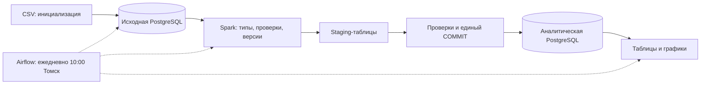

# ETL результатов CRM-эксперимента

Самостоятельный pet-проект: исходная PostgreSQL → настоящие преобразования Spark → отдельная аналитическая PostgreSQL. Airflow запускает DAG по расписанию, проверяет данные и формирует таблицы и графики.

**Текущий статус:** проект выполнен и проверен на полном датасете. Пройдены 9 тестов Spark/DAG, повторная публикация, откат при ошибке и сверка с исходным CSV. Настоящие ручной и автоматический запуски Airflow завершились успешно; ежедневное расписание включено.

[Архитектура и история решений](docs/architecture.md) · [Результаты запусков](results/index.md)

## Поток данных



Датасет Hillstrom — исторические результаты CRM-рассылки за 14 дней, тот же открытый источник, что в соседнем A/B-проекте. Здесь не повторяется статистическое исследование: строится инфраструктура, которая готовит данные для аналитика. `snapshot_date` означает дату загрузки, не покупки. В исходнике нет событий с датами, поэтому ежедневные снимки архива не выдаются за динамику бизнеса.

## Запуск одной командой

Нужен Docker Desktop с Linux engine и свободное место для образа Spark/Airflow. Из папки проекта в PowerShell:

```powershell
./scripts/run-demo.ps1 -SnapshotDate 2026-10-28
```

Скрипт собирает образ, запускает три сервиса, инициализирует источник, выполняет тесты, три сквозных проверки и настоящий DAG через API Airflow. Порт интерфейса — [localhost:8085](http://localhost:8085). В локальном учебном окружении вход упрощён; порт опубликован только на localhost.

Последовательность вручную, также для Linux/macOS:

```text
docker compose up -d --build --wait --wait-timeout 240
docker compose exec -T airflow python -m pipeline.seed
docker compose exec -T airflow python scripts/run_unit_tests.py
docker compose exec -T airflow python scripts/verify_pipeline.py --snapshot-date 2026-10-28
docker compose exec -T airflow python scripts/render_dag.py
docker compose exec -T airflow python scripts/verify_airflow.py --snapshot-date 2026-10-28
```

Остановить только этот проект, сохранив его данные:

```text
docker compose stop
```

## Что именно делает Spark

1. Читает сырую таблицу источника через JDBC, с зафиксированным верхним ingest_id.
2. Приводит строки к типам, денежные поля — к decimal.
3. Проверяет обязательные поля и допустимые значения; сохраняет ошибки в карантин.
4. Выбирает последнюю корректную версию технического ID покупателя. Совпадающие признаки разных покупателей не удаляет.
5. Строит факты покупателей и агрегаты по исходной группе и каналу прежних покупок.
6. Записывает результат в уникальные staging-таблицы целевой PostgreSQL.

Публикация всех витрин одной даты проходит в общей транзакции. Сверка численности, покупок и выручки происходит до COMMIT; ошибка откатывает изменения. Повтор снимка не прибавляет данные к предыдущему снимку. Это полный снимок небольшого источника, не CDC и не инкрементальная загрузка. Spark работает локально на двух потоках; распределённый кластер здесь не имитируется.

## Какие данные должны получиться

64 000 оригинальных строк. Для проверки добавлены **5 учебных дублей** и **7 учебных ошибочных строк**, явно помеченных `is_demo`. Ожидается 64 012 сырых строк → 64 000 покупательских фактов, 5 исключённых технических дублей, 7 строк карантина. Эти числа подтверждены фактическим прогоном; доказательства сохранены в `results/verification.json`.

Таблицы в целевой базе:

| Таблица | Содержание |
| --- | --- |
| customer_facts | Покупатель, группа, канал, покупки и выручка на дату снимка |
| experiment_metrics | Участники, покупатели, выручка, конверсия, выручка на участника |
| channel_metrics | Срез по группе и каналу покупок до эксперимента |
| quarantine | Некорректная исходная строка и причина отклонения |
| etl_runs | Успешные и неудачные попытки с контрольной суммой источника |

## Файлы

```text
compose.yaml              Изолированные сервисы PostgreSQL и Airflow
Dockerfile                Airflow + Java + Spark + JDBC
pipeline/seed.py          Однократная инициализация источника
pipeline/job.py           Извлечение, Spark, транзакционная публикация
pipeline/report.py        Таблицы, PNG, HTML и Markdown
dags/crm_daily_etl.py      Ежедневный DAG из четырёх задач
tests/                    Проверки Spark и контракта DAG
scripts/verify_pipeline.py Повторяемость, сверка с CSV и rollback
scripts/verify_airflow.py  Настоящий запуск DAG и проверка состояний задач
data/raw/                 Неизменённый CSV и его SHA-256
results/                  Фактические результаты и доказательства проверки
```

Если сборка Docker сообщает `read-only file system` после заполнения C:, сначала нужно восстановить свободное место либо перенести disk image через настройки Docker Desktop. После этого запусти Docker заново и повтори сборку. Общая очистка Docker и удаление томов скриптом не выполняются.
