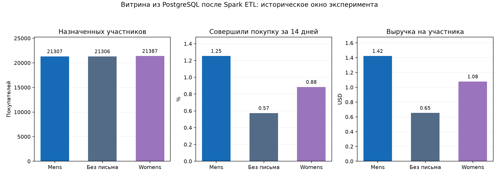
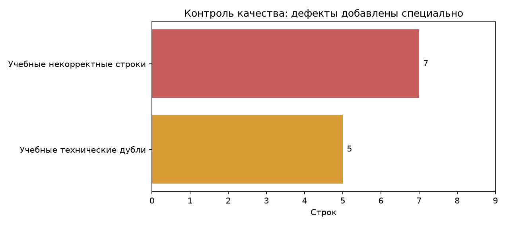

# ETL результатов CRM-эксперимента

## Что получилось

Данные прочитаны **из PostgreSQL через JDBC**, преобразованы настоящим Spark и опубликованы **в отдельную PostgreSQL**. Дата снимка: **2026-10-28**. Исторический датасет содержит итоговые показатели за 14 дней; эта дата обозначает загрузку, а не день покупки.

Прочитано **64,012** строк. В факты принято **64,000** покупателей, исключено **5** учебных технических дублей, в карантин помещено **7** специально испорченных строк. Оригинальные 64 000 покупателей сохранены. Большие покупки и нулевые траты не удалялись.

## Таблицы для аналитика

| Исходная группа | Участников | Купили | Выручка, USD | Конверсия | Выручка на участника, USD |
| --- | ---: | ---: | ---: | ---: | ---: |
| Mens E-Mail | 21,307 | 267 | 30311.69 | 1.253% | 1.423 |
| No E-Mail | 21,306 | 122 | 13908.33 | 0.573% | 0.653 |
| Womens E-Mail | 21,387 | 189 | 23038.11 | 0.884% | 1.077 |

Это описательные агрегаты, без новой проверки A/B-гипотез. Канальные срезы относятся к покупкам до эксперимента, а не источникам рекламного привлечения. Витрина позволяет продолжить A/B-анализ; история эксперимента не превращается в текущие банковские транзакции.

Таблицы: [группы](experiment_metrics.csv), [каналы покупок до эксперимента](channel_metrics.csv), [карантин](quarantine.csv), [образец 50 покупательских фактов](customer_facts_sample_50.csv). Полная таблица фактов хранится в целевой базе.

## Контроль качества и повторяемость

Проверяются обязательные поля используемых витриной признаков, допустимые значения, неотрицательные денежные суммы и соответствие покупки положительным тратам. Некорректные исходные строки сохраняются с причинами; после типизации выбирается последняя корректная версия технического ID покупателя.

Пять дублей и семь ошибок созданы в загрузчике для тестирования, помечены `is_demo`; они не являются заявлением о качестве оригинального архива. Совпадение всех известных признаков разных исходных покупателей не служит основанием удалять их строки.

Публикация использует уникальные staging-таблицы и одну транзакцию для всех витрин указанной даты. Проверки числа покупателей и сверки фактов с агрегатами выполняются до COMMIT. Ошибка откатывает публикацию. Повтор снимка заменяет его содержимое, не прибавляя покупателей или выручку. Другие даты сохраняются. Это полный снимок малого источника, без CDC.

Сверено в хранилище: 64,000 покупателей, 578 покупателей с покупкой, 67258.13 USD. Денежные суммы сохраняются в decimal и сверяются точно; средние в витрине хранятся с плавающей точкой.

## Airflow

DAG `crm_daily_etl`: `extract_source_bound → spark_transform_and_publish → check_warehouse → build_report`. Расписание — ежедневно в **10:00 Asia/Tomsk**, одна повторная попытка, запрет одновременных запусков DAG. Через XCom проходят счётчики и параметры, не таблицы покупателей. Переиспользуются те же Python-функции, что и в локальном CLI.

Интерфейс: [Airflow на localhost](http://localhost:8085). Факт запуска и проверки повторяемости подтверждаются отдельно в [результатах проверки](../verification.json); наличие DAG-файла не подменяет успешное выполнение.

## Происхождение и аудит

[Автор исходного эксперимента — Hillstrom / MineThatData](https://blog.minethatdata.com/2008/03/minethatdata-e-mail-analytics-and-data.html). SHA-256 CSV: `0e5893329d8b93cefecc571777672028290ab69865718020c78c7284f291aece`. Верхняя граница извлечения: ingest_id ≤ 64012. Идентификатор опубликованного запуска: `71d78d0a60844fcb8e11942cc454493a`. Время ETL в этом запуске: 18.08 с; это локальное измерение, а не оценка масштабируемости кластера.

## Формулировка для анкеты

«Реализовал ETL-пайплайн PostgreSQL → Spark → PostgreSQL для аналитики CRM-эксперимента на 64 тыс. покупателей. Настроил DAG Airflow с ежедневным расписанием, повторными попытками и проверками качества. Выполнил типизацию, дедупликацию по техническому ID, карантин ошибочных строк, построение фактов и продуктовых витрин. Реализовал атомарную публикацию снимка и проверил повторный запуск без задвоения и откат при ошибке. Подготовил таблицы и графики для продуктового анализа».
